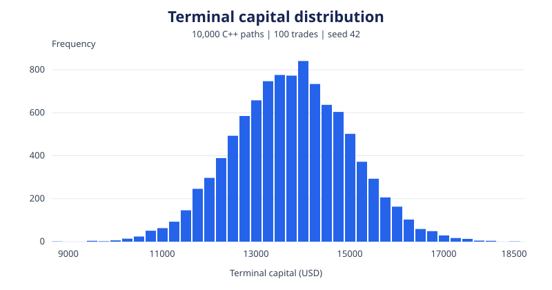
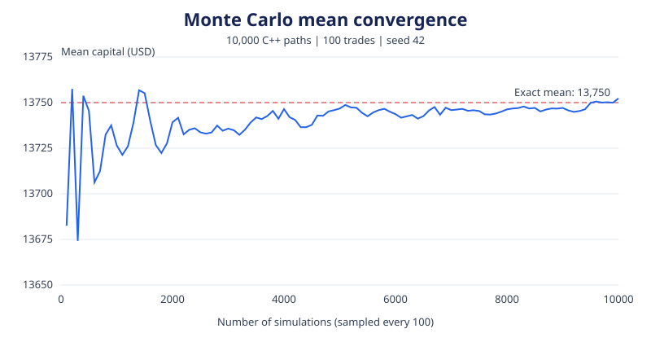

# Monte Carlo Trading Simulator (C++)

[](https://github.com/santiago-pascual/Montecarlo-Simulation/actions/workflows/ci.yml)

A small, reproducible C++17 quantitative-finance project for studying fixed-dollar trade outcomes. It simulates independent trading paths and compares their terminal equity distribution with an **exact binomial model**.

## Features

- Configurable initial capital, win probability, profit on a win, loss on a loss, trade count and simulation count
- Reproducible `std::mt19937` pseudorandom generator with explicit seed
- Theoretical and empirical terminal mean, variance and standard deviation
- Terminal equity P5, median and P95 (linearly interpolated sample quantiles)
- Per-path maximum drawdown, mean and worst maximum drawdown
- Probability that equity **ever reaches 50% or less of initial capital** (path-based ruin threshold)
- Optional per-simulation CSV export
- Mathematical validation tests, CMake build and GitHub Actions CI

## Mathematical model

Each trade independently wins `W` with probability `p`, otherwise loses `L` (where `L > 0`). Profit and loss are **fixed dollar amounts**, not percentages of equity. For `N` trades and starting capital `C0`:

```text
K ~ Binomial(N, p)
Final capital = C0 + (W + L) * K - N * L
E[Final capital] = C0 + N * (p*W - (1-p)*L)
Var[Final capital] = N * p * (1-p) * (W + L)^2
```

Drawdown at each trade is `(running_peak - equity) / running_peak`, with the running peak initialized to starting capital. Maximum drawdown is the largest such observation along a path. The default ruin event is *ever reaching or crossing 50% of starting capital*, including if the path subsequently recovers.

The model **does not stop trading at the ruin threshold** and can produce negative equity. Thus drawdown can exceed 100%; the threshold is a descriptive risk statistic, not a broker liquidation model.

## Build and run

With a C++17 compiler (no third-party dependencies):

```bash
g++ -std=c++17 -O2 -Wall -Wextra montecarlosim.cpp -o simulator
./simulator
```

In PowerShell, compile with `-o simulator.exe` and run `.\simulator.exe`.

The default run uses `10,000` simulations, `100` trades per simulation, `$10,000` starting capital, a `55%` win rate, `$150` per win, `$100` per loss, and seed `42`.

Override the defaults with positional arguments:

```bash
./simulator 10000 100 10000 55 150 100 42
./simulator 10000 100 10000 55 150 100 42 results.csv
```

Arguments are `simulations trades capital win_rate_percent win_profit loss_amount seed [optional_csv_filename]`. The seed is an unsigned 32-bit integer. Reusing the same seed and toolchain reproduces the same run; the C++ standard does not require all distribution implementations to produce identical sequences across different standard libraries.

### Example: independent theoretical benchmark

For the default parameters, the **exact analytical values** (not simulated output) are:

| Statistic | Theoretical value |
|---|---:|
| Expected profit per trade | $37.50 |
| Expected final capital | $13,750.00 |
| Terminal capital variance | 1,546,875 dollars squared |
| Terminal capital standard deviation | $1,243.73 |

The empirical values and percentiles are printed by the program and depend on the chosen random seed. With sufficiently many simulations, sample mean and variance should approach these theoretical values. The distribution is discrete and binomial, not necessarily normal.

### Empirical validation

10,000 independent paths, 100 trades per path, seed 42. Results from the C++ CSV export; all local mathematical and reproducibility tests passed.

| Metric | Theoretical | Empirical | Relative error |
|---|---:|---:|---:|
| Mean (USD) | 13,750.00 | 13,752.27 | 0.0165% |
| Variance (USD²) | 1,546,875.00 | 1,539,480.02 | 0.4781% |
| Standard deviation (USD) | 1,243.73 | 1,240.76 | 0.2393% |

### Terminal capital distribution



### Monte Carlo mean convergence



The histogram uses observed terminal capital frequencies. The convergence chart uses cumulative means sampled every 100 paths in their original simulation order. Neither figure uses synthetic resampling or a fitted normal distribution.

### CSV export

An optional CSV includes one row per simulated path with columns `simulation,final_capital,max_drawdown_pct,hit_ruin`. The export records the path outcome, not every trade's equity. It can be plotted in Python, R, spreadsheets or other analysis tools.

## Automated tests

```bash
cmake -S . -B build
cmake --build build
ctest --test-dir build --output-on-failure
```

Without CMake:

```bash
g++ -std=c++17 -O2 -Wall -Wextra tests/test_simulator.cpp -o simulator_tests
./simulator_tests
```

Tests cover exact analytical moments, percentile interpolation, reproducible seeds, empirical-moment tolerance, all-win/all-loss scenarios, drawdown/ruin and invalid input rejection. GitHub Actions builds and runs them on pushes and pull requests.

## Assumptions and limitations

- Independent Bernoulli trade outcomes, constant win probability, fixed nominal P&L
- No fees, slippage, variable sizing, leverage, market regimes or time-dependent probabilities
- No broker margin or liquidation constraints; trading continues after capital depletion
- Drawdown uses mark-to-model equity *after each trade*, not intratrade prices
- Fixed 50% ruin threshold for this version
- Confidence intervals and real-data calibration are outside this educational model's scope

This project is educational and does not predict real trading results or constitute investment advice.
